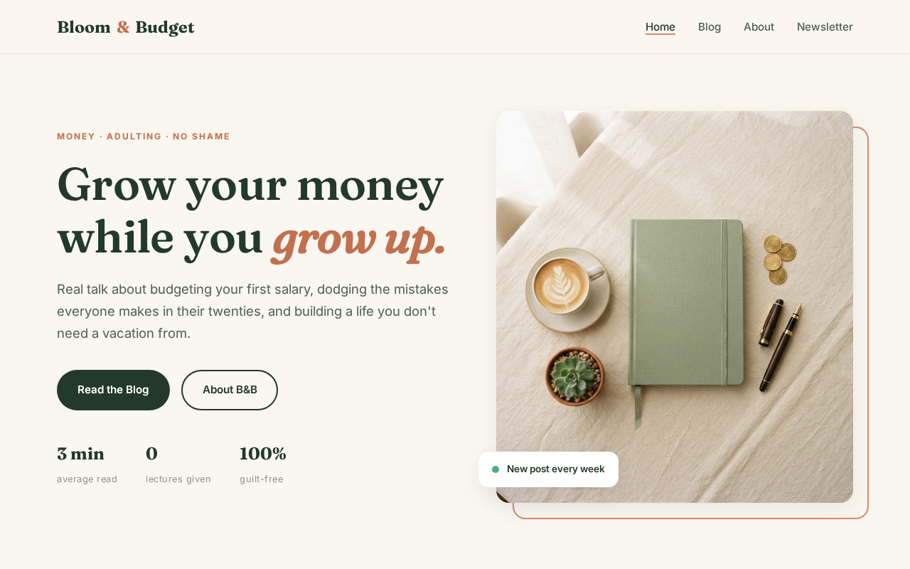

# Bloom & Budget

**Live site: [bloomandbudget.vercel.app](https://bloomandbudget.vercel.app/)**

A fast, professional static blog for the Bloom & Budget brand — money & adulting content for young women. Deliberately built with **no frameworks and no build tools**: pure HTML + CSS with a hand-crafted design system, so it loads instantly and can be hosted anywhere for free.



## What it does

- Branded homepage with featured articles
- Three fully written, structured posts: budgeting a first salary, common money mistakes, and building an emergency fund
- About + contact page
- Complete hand-built design system (typography, color, cards, spacing) in a single stylesheet
- Fully responsive and SEO-friendly (semantic HTML, meta descriptions, per-page titles)

## Built with

- Pure HTML + CSS — zero dependencies, zero build step
- Deployed on Vercel with automatic deploys from this repo

## Repository guide

A quick map of the files:

```
bloom-budget-blog/
├── index.html                  ← homepage
├── about.html                  ← about + contact
├── css/
│   └── styles.css              ← entire design system
├── img/                        ← hero + article cover images
├── posts/                      ← the three full articles
└── README.md
```

Adding a new post: copy any file from `posts/`, change the title/meta/content, add a cover image to `img/`, and link it from the homepage card grid.

---

**Muhammad Umair** — freelance web developer, Abbottabad, Pakistan

- Portfolio: [portfolio-3d-nine-alpha.vercel.app](https://portfolio-3d-nine-alpha.vercel.app/)
- GitHub: [github.com/umairkhn1](https://github.com/umairkhn1)
- Email: nsumair006@gmail.com
